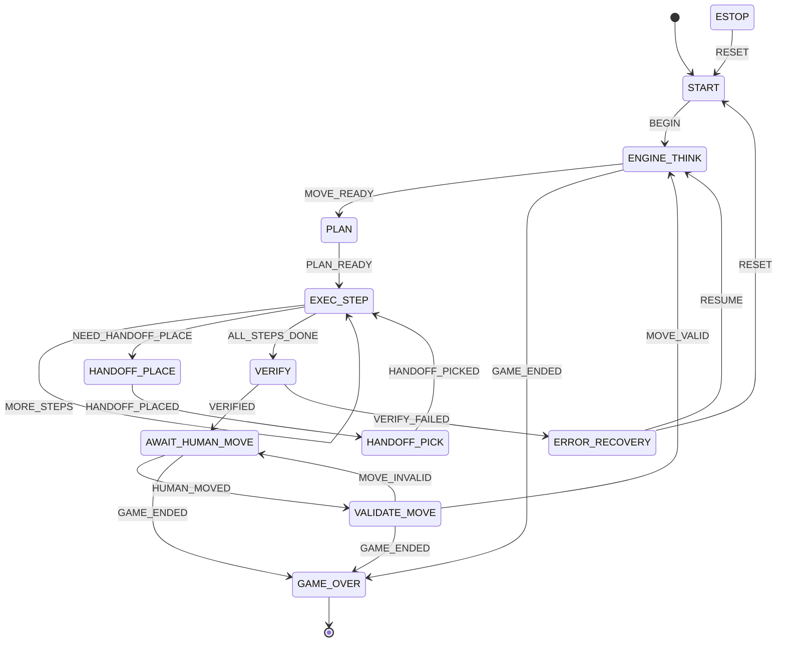

# Orchestration state machine

Defined in `src/magnus_bot/orchestration/state_machine.py` as an `Enum` of states plus an
explicit `(state, event) → state` transition table. It is **pure** (no hardware), so the whole
table is unit-tested; the executor supplies events from real or simulated hardware. The robots
play White and move first, so each cycle begins by thinking.

## Diagram

`FAULT` (→ `ERROR_RECOVERY`) and `ESTOP` (→ `ESTOP`) are valid from **any** non-terminal state and
are handled globally in `next_state`, so they are omitted from the arrows above to keep the
diagram readable. `GAME_OVER` is terminal.

## States

| state | meaning |
|-------|---------|
| START | idle, before the game begins |
| ENGINE_THINK | the robots' move source produces a move |
| PLAN | decompose + assign + build the motion program |
| EXEC_STEP | execute the next single-arm transfer |
| HANDOFF_PLACE / HANDOFF_PICK | arm A places on the pad / arm B picks from it |
| VERIFY | confirm the board matches the intended position (M4: via camera) |
| AWAIT_HUMAN_MOVE | wait for the human to move |
| VALIDATE_MOVE | check the human's move is legal |
| ERROR_RECOVERY | a fault occurred; hold and await RESUME/RESET |
| ESTOP | emergency stop; hold, await RESET |
| GAME_OVER | terminal |

## Safety coupling

`ERROR_RECOVERY`/`ESTOP` follow safety rule 3: stop commanding and **hold position** (do not cut
torque). The executor enters them on any fault and must have executed a sim pass before any
two-arm motion (safety rule 4).
